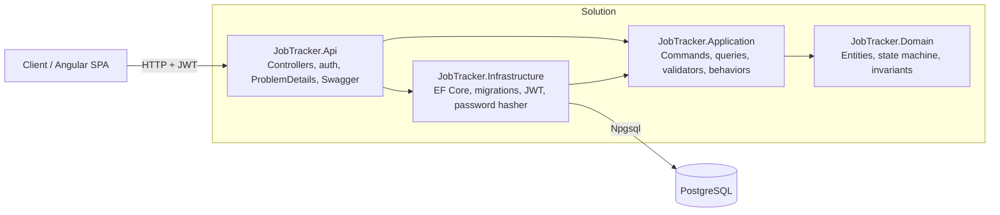
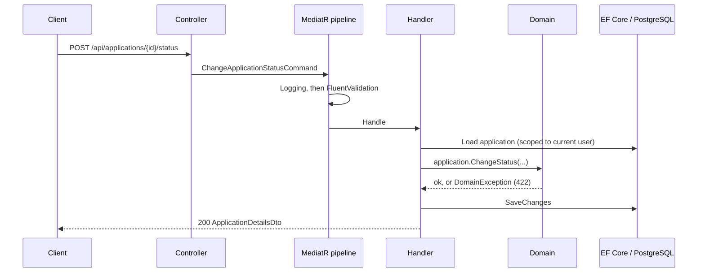
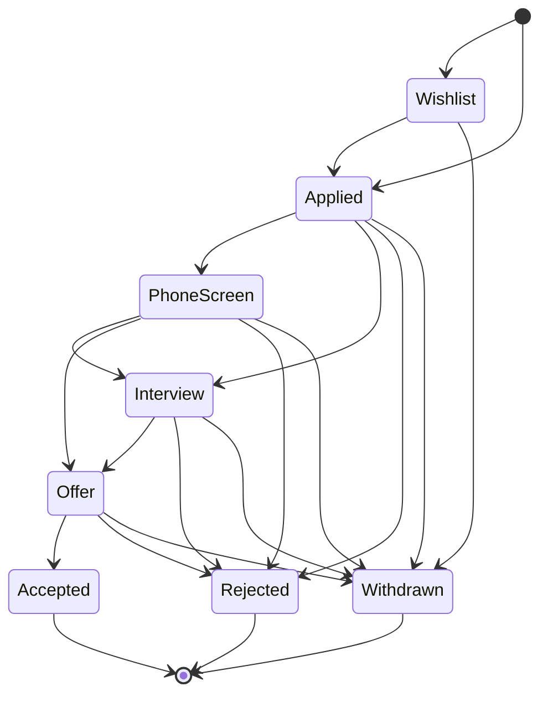

# Job Application Tracker API

[](https://github.com/AhmedSamiir51/job-application-tracker-api/actions/workflows/ci.yml)


A production-style REST API for tracking job applications through the hiring pipeline
(Wishlist, Applied, Phone Screen, Interview, Offer, Accepted, Rejected, Withdrawn).

I built it as a reference for how I structure .NET back ends: Clean Architecture, CQRS with MediatR,
a domain model that protects its own invariants, consistent error handling, and tests at three levels.

## Highlights

- **Clean Architecture** with strict dependency direction: `Domain <- Application <- Infrastructure / Api`.
- **CQRS with MediatR.** Every use case is a command or query with its own handler and validator.
- **Rich domain model.** `JobApplication` is an aggregate root. The status pipeline is a small state machine, so illegal transitions (for example `Wishlist -> Offer`) are impossible rather than merely discouraged.
- **FluentValidation in a MediatR pipeline behavior**, so validation runs for every request, not just HTTP ones.
- **RFC 9457 problem details** for every error. Validation (400), auth (401), not found (404), conflict (409), business rule (422), unexpected (500, no internal details leaked).
- **JWT bearer auth** with PBKDF2-SHA256 password hashing (210k iterations, per-password salt, constant-time compare). Login errors do not reveal whether an email exists.
- **Per-user data isolation.** Every query is scoped to the caller. Another user's resource is a 404, not a 403.
- **Filtering, searching, sorting and pagination** on the list endpoint, with a page size cap.
- **EF Core 10 + PostgreSQL**, code-first migrations, indexes that match the query shapes.
- **Swagger / OpenAPI** with a JWT "Authorize" button, XML doc comments, and typed responses.
- **Operational touches:** health check, rate limiting on auth endpoints, CORS for a SPA, strongly typed and validated options (`ValidateOnStart`), warnings treated as errors.
- **Tests:** 90 tests (domain unit tests, handler tests on real EF Core + SQLite, and full HTTP integration tests through `WebApplicationFactory`).
- **Docker** multi-stage image (non-root) + `docker-compose` with PostgreSQL, and a **GitHub Actions** pipeline.

## Architecture



Request flow:



| Project | Responsibility | Depends on |
| --- | --- | --- |
| `JobTracker.Domain` | Entities, enums, status rules, `DomainException`. No dependencies. | none |
| `JobTracker.Application` | Use cases (CQRS), validators, pipeline behaviors, abstractions (`IAppDbContext`, `ICurrentUser`, ...). | Domain |
| `JobTracker.Infrastructure` | EF Core `DbContext`, configurations, migrations, JWT and password hashing. | Application |
| `JobTracker.Api` | HTTP surface, composition root, middleware, Swagger. | Application, Infrastructure |

### Status pipeline



Every transition is recorded in an audit trail (`status_changes`) and returned with the application.

## Tech stack

| Area | Choice |
| --- | --- |
| Runtime | .NET 10 (LTS), ASP.NET Core controllers |
| Data | EF Core 10, PostgreSQL (Npgsql), migrations |
| Patterns | Clean Architecture, CQRS, MediatR 12, aggregate root, state machine |
| Validation | FluentValidation 12 |
| Auth | JWT bearer (`Microsoft.IdentityModel.JsonWebTokens`), PBKDF2 |
| Docs | Swashbuckle (Swagger UI) |
| Tests | xUnit, EF Core SQLite in-memory, `WebApplicationFactory`, coverlet |
| DevOps | Docker, docker-compose, GitHub Actions |

## Run locally

Prerequisites: [.NET 10 SDK](https://dotnet.microsoft.com/download) and a PostgreSQL instance
(the quickest way is `docker compose up db -d`).

```bash
git clone https://github.com/AhmedSamiir51/job-application-tracker-api.git
cd job-application-tracker-api

docker compose up db -d                 # PostgreSQL on localhost:5432
dotnet run --project src/JobTracker.Api # http://localhost:5080 (Development profile)
```

In `Development` the app applies migrations on startup and uses a throw-away signing key from
`appsettings.Development.json`. Open **http://localhost:5080/swagger**.

Configuration (environment variables use `__` as the separator):

| Key | Purpose | Default |
| --- | --- | --- |
| `ConnectionStrings__Default` | PostgreSQL connection string | local Postgres |
| `Jwt__SigningKey` | HMAC key, **at least 32 characters, required** | none (dev key in Development) |
| `Jwt__ExpiryMinutes` | Token lifetime | `60` |
| `Database__MigrateOnStartup` | Apply EF migrations at startup | `false` (`true` in Development) |
| `Cors__Origins__0` | Allowed SPA origin | `http://localhost:4200` |

The app refuses to start if the signing key is missing or too short.

## Run with Docker

```bash
docker compose up --build
```

The API is on **http://localhost:8080** (health check: `/health`). Migrations are applied on startup.
To use your own signing key: `JWT_SIGNING_KEY=$(openssl rand -base64 48) docker compose up --build`.
To expose Swagger in the container, copy `docker-compose.override.example.yml` to `docker-compose.override.yml`.

## API examples

```bash
BASE=http://localhost:5080

# 1. Register (returns a token) or log in
curl -s -X POST $BASE/api/auth/register -H 'Content-Type: application/json' \
  -d '{"email":"ahmed@example.com","fullName":"Ahmed Samir","password":"Passw0rd1"}'

TOKEN=$(curl -s -X POST $BASE/api/auth/login -H 'Content-Type: application/json' \
  -d '{"email":"ahmed@example.com","password":"Passw0rd1"}' | jq -r .accessToken)

# 2. Create an application
curl -s -X POST $BASE/api/applications -H "Authorization: Bearer $TOKEN" -H 'Content-Type: application/json' \
  -d '{"companyName":"Contoso","position":"Senior .NET Engineer","workMode":"Remote",
       "salaryMin":4000,"salaryMax":6000,"currency":"USD","status":"Applied"}'

# 3. Move it through the pipeline
curl -s -X POST $BASE/api/applications/$ID/status -H "Authorization: Bearer $TOKEN" \
  -H 'Content-Type: application/json' -d '{"status":"Interview","comment":"Technical round booked"}'

# 4. Add a note
curl -s -X POST $BASE/api/applications/$ID/notes -H "Authorization: Bearer $TOKEN" \
  -H 'Content-Type: application/json' -d '{"text":"Recruiter asked for salary expectations"}'

# 5. List with filters, search, sorting and paging
curl -s "$BASE/api/applications?status=Applied&workMode=Remote&search=contoso&sortBy=Company&descending=false&page=1&pageSize=10" \
  -H "Authorization: Bearer $TOKEN"

# 6. Dashboard numbers
curl -s $BASE/api/applications/stats -H "Authorization: Bearer $TOKEN"
```

### Endpoints

| Method | Route | Description |
| --- | --- | --- |
| POST | `/api/auth/register` | Create an account, returns a JWT |
| POST | `/api/auth/login` | Log in, returns a JWT |
| GET | `/api/applications` | List (filter: `status`, `workMode`, `company`, `search`, `appliedFrom`, `appliedTo`; sort: `sortBy`, `descending`; paging: `page`, `pageSize` max 100) |
| GET | `/api/applications/stats` | Totals, active, offers, response rate, counts by status |
| GET | `/api/applications/{id}` | Details with notes, history and allowed transitions |
| POST | `/api/applications` | Create (starts as `Wishlist` or `Applied`) |
| PUT | `/api/applications/{id}` | Update descriptive fields |
| POST | `/api/applications/{id}/status` | Change pipeline status (422 if the transition is not allowed) |
| POST | `/api/applications/{id}/notes` | Add a note |
| DELETE | `/api/applications/{id}` | Delete application, notes and history |
| GET | `/health` | Liveness and database check |

### Example responses

Paged list:

```json
{
  "items": [
    {
      "id": "510c6dc4-ed95-4602-a288-48867d8d4f4d",
      "companyName": "Contoso",
      "position": "Senior .NET",
      "location": null,
      "workMode": "Remote",
      "status": "Interview",
      "appliedAtUtc": "2026-11-23T23:16:33.752473Z",
      "createdAtUtc": "2026-11-23T23:16:33.752473Z",
      "updatedAtUtc": "2026-11-23T23:16:34.011Z"
    }
  ],
  "page": 1,
  "pageSize": 20,
  "totalCount": 1,
  "totalPages": 1,
  "hasPrevious": false,
  "hasNext": false
}
```

Business rule violation (`422`):

```json
{
  "type": "https://tools.ietf.org/html/rfc4918#section-11.2",
  "title": "The request violates a business rule.",
  "status": 422,
  "detail": "Cannot move an application from Interview to Wishlist.",
  "traceId": "0HNQ9MV83UC1F:00000001"
}
```

Validation failure (`400`) uses `ValidationProblemDetails` with an `errors` object keyed by field.

## Tests

```bash
dotnet test                                              # everything
dotnet test --collect:"XPlat Code Coverage"              # with coverage
```

| Suite | What it covers |
| --- | --- |
| `JobTracker.Domain.Tests` | Aggregate invariants, every allowed and forbidden status transition, terminal states, notes |
| `JobTracker.Application.Tests` | Handlers against real EF Core on in-memory SQLite: auth, CRUD, filtering, search, sorting, paging, per-user isolation, stats maths, validators, password hasher |
| `JobTracker.Api.Tests` | The real HTTP pipeline via `WebApplicationFactory`: auth flow, 401/400/404/409/422 problem details, full application lifecycle, query-string filtering and paging, OpenAPI generation |

Tests use SQLite so they run anywhere with no setup. I also exercised the PostgreSQL migration and the main flows
against a real PostgreSQL instance while building this.

## Project structure

```
.
├── src/
│   ├── JobTracker.Domain/           # entities, enums, state machine
│   ├── JobTracker.Application/      # CQRS features, validators, behaviors, abstractions
│   ├── JobTracker.Infrastructure/   # EF Core, migrations, JWT, hashing
│   └── JobTracker.Api/              # controllers, middleware, Swagger, Program.cs
├── tests/
│   ├── JobTracker.Domain.Tests/
│   ├── JobTracker.Application.Tests/
│   └── JobTracker.Api.Tests/
├── Dockerfile
├── docker-compose.yml
└── .github/workflows/ci.yml
```

## Design decisions

- **Why handlers use `IAppDbContext` directly instead of a repository layer.** EF Core already is a unit of work and repository. Wrapping it adds indirection without adding testability, because the handlers are tested against a real provider.
- **Why 404 for another user's resource.** It avoids confirming that an id exists.
- **Why a state machine in the domain.** The rules live next to the data they protect, and the API exposes `allowedTransitions` so a UI never has to duplicate them.
- **Why `TimeProvider`.** Time is injected, so tests control it and timestamps are deterministic.
- **Why MediatR 12.** It is the last release under the Apache 2.0 license.

## Possible next steps

- Refresh tokens and email confirmation
- Reminders for follow-ups (background service + outbox)
- An Angular dashboard consuming this API
- Testcontainers-based tests against PostgreSQL in CI

## License

MIT, see [LICENSE](LICENSE).
